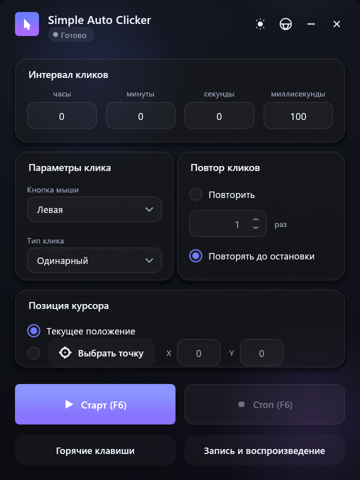
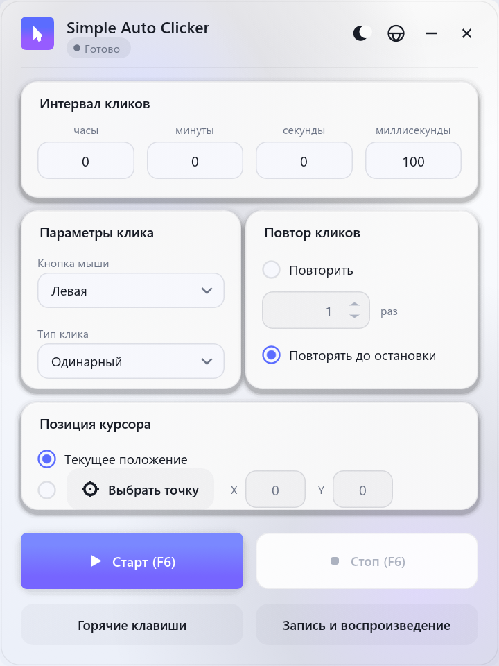
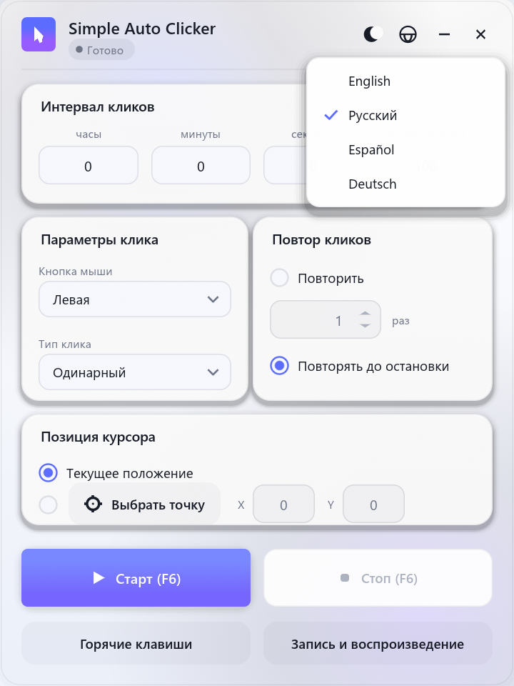
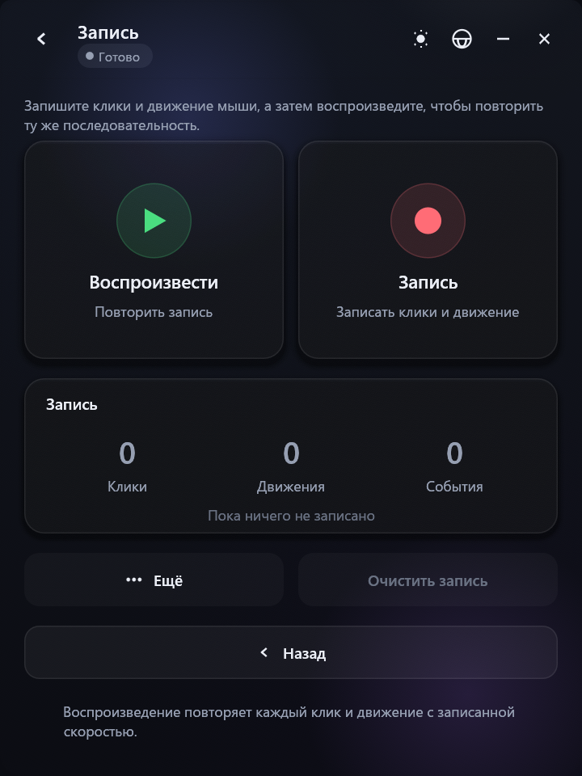
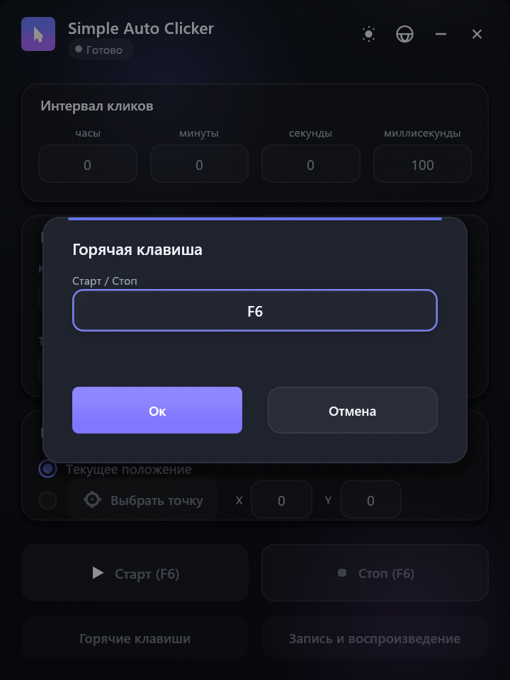

# Simple Auto Clicker

A fast, lightweight auto clicker for Windows with a modern translucent interface,
smooth animations and a built-in record & playback. Fixed compact window, no
installer, no background services — just one small `SimpleAutoClicker.exe`.



## Features

- **Click interval** — hours, minutes, seconds and milliseconds.
- **Mouse button** — left, right or middle, single or double clicks.
- **Click repeat** — a fixed number of times or until stopped.
- **Cursor position** — click wherever the cursor is, or pin an exact screen point.
- **Global hotkey** — start / stop with `F6` by default; any key can be assigned.
- **Record & playback** — records clicks *and* mouse movement with their original
  timing, then replays the sequence. Separate hotkeys for playback and recording,
  optional auto-minimize, and clicks on the app's own window are ignored while recording.
- **Themes** — System, Light and Dark, switched live with a short animation.
- **Four languages** — English, Russian, Spanish and German, picked automatically from
  the Windows display language and switchable at any time.
- **Remembers everything** — theme, language, hotkeys and minimize options survive a restart.

The window is a compact, fixed-size 480×640 panel with a custom title bar, frosted
glass cards, a drifting gradient backdrop and animated controls. It cannot be
maximized or made fullscreen — by design.

## Screenshots

| Light theme | Language menu |
| --- | --- |
|  |  |

| Record & Playback | Hotkey setting |
| --- | --- |
|  |  |

## Download

Grab the latest `SimpleAutoClicker.exe` from the
[Releases](https://github.com/fay9to/simple-autoclicker/releases) page and run it.
It is a single self-contained file; nothing else has to be installed.

Windows SmartScreen may warn about an unsigned executable downloaded from the
internet. Choose **More info → Run anyway**.

## Usage

### Clicking

1. Set the click interval.
2. Pick the mouse button and the click type.
3. Choose a fixed repeat count or leave **Repeat until stopped**.
4. Choose **Current location** or **Pick location** and click the point on screen.
5. Press **Start** — or the hotkey — to begin, and **Stop** to end.

### Record & Playback

1. Open **Record & Playback** from the main window.
2. Press **Record**, perform the clicks and mouse movements you need, then press **Stop**.
3. Press **Playback** to repeat the recording with the same timing.

Clicks on the app itself are ignored while recording, so pressing **Stop** does not
end up in the recording. A recording lives in memory only and is gone when the app
closes.

## Hotkeys

| Action | Default key |
| --- | --- |
| Start / stop clicking | `F6` |
| Start / stop playback | not assigned |
| Start / stop recording | not assigned |

All three can be changed in the app: **Hotkey setting** on the main window, and
**More → Hotkeys…** on the recording screen. The recording hotkeys are only active
while that screen is open. Global hotkeys keep working while the window is minimized,
and stopping a minimized recording or playback restores the window.

If another program already owns a key, the previous binding is kept and the app
explains why.

## Languages

The interface ships in English, Русский, Español and Deutsch. On the first run the
language follows the Windows display language; the globe button in the title bar
switches it afterwards. The choice is stored in the settings file.

## Settings

```
%LOCALAPPDATA%\SimpleAutoClicker\settings.ini
```

It keeps the theme, the language, the hotkeys and the two minimize options. Delete
the file to return to the defaults. No other data is written to disk.

## Build from source

Requirements: Windows 10 or 11 (64-bit) and a stable Rust toolchain with the MSVC
target — for example [rustup](https://rustup.rs) plus the Visual Studio Build Tools
with *Desktop development with C++*.

```powershell
git clone https://github.com/fay9to/simple-autoclicker.git
cd simple-autoclicker
cargo build --release
.\target\release\SimpleAutoClicker.exe
```

## Project layout

| Path | Purpose |
| --- | --- |
| `src/main.rs` | entry point and the fixed-size translucent window |
| `src/app/mod.rs` | application state, custom title bar, background and update loop |
| `src/app/main_screen.rs` | main window layout and actions |
| `src/app/advanced_screen.rs` | record & playback screen |
| `src/app/menus.rs` | popup menus and their actions |
| `src/engine.rs` | click loop running on a background thread |
| `src/record.rs` | recording storage, filtering and playback thread |
| `src/hooks.rs` | low-level mouse hook used by the recorder |
| `src/hotkeys.rs` | global hotkeys on a dedicated message-loop thread |
| `src/native.rs` | Win32 calls: mouse input, window lookup, size lock, DWM styling |
| `src/i18n.rs` | translations for all four languages |
| `src/theme.rs` | palettes, gradients, shadows, fonts and vector icons |
| `src/widgets.rs` | animated cards, buttons, fields, selects, radios and menus |
| `src/dialogs.rs` | modal dialogs drawn inside the window |
| `src/settings.rs` | settings file |
| `src/keys.rs` | virtual-key names and conversions |

## Notes

- Only one window can own a given global hotkey.
- The app does not require administrator rights; elevated windows may ignore synthetic
  clicks.
- The Cargo package is called `simple-autoclicker`, the executable is
  `SimpleAutoClicker.exe`.

## License

[MIT](LICENSE)
