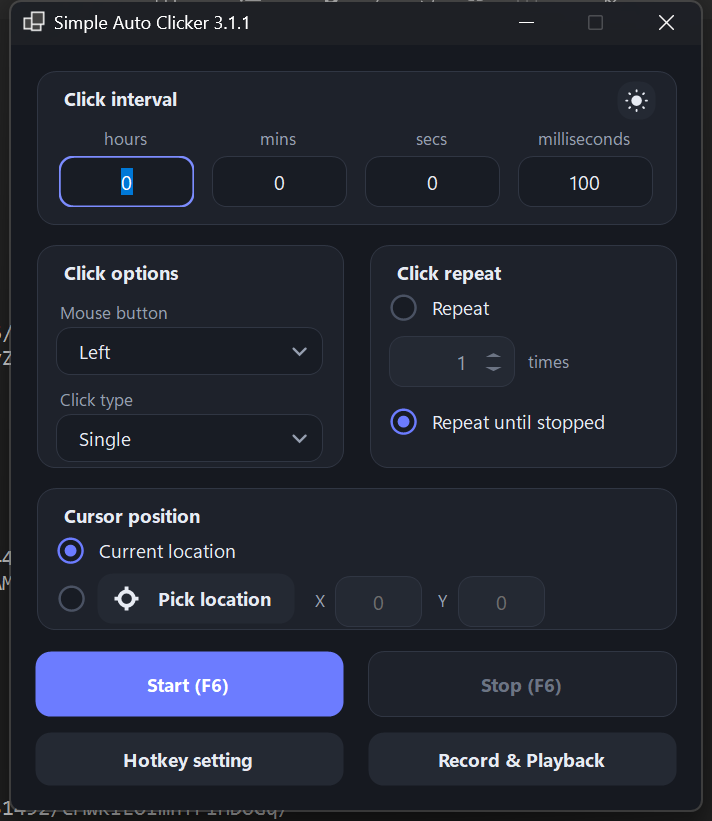
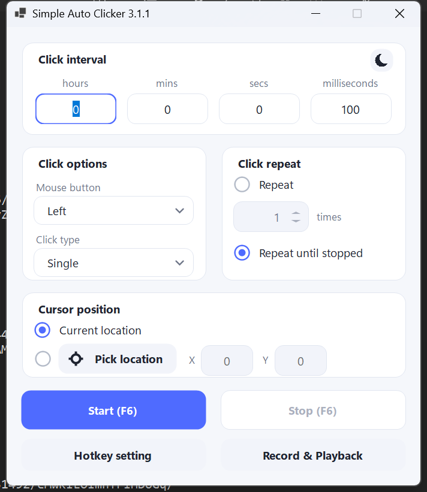
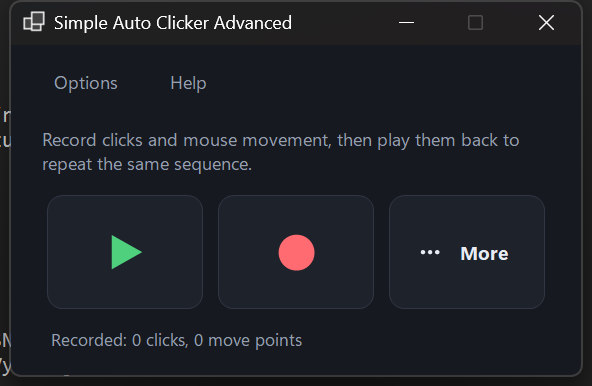
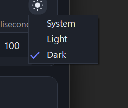

# Simple Auto Clicker

A small, sharp-looking auto clicker for Windows, written in C# / WinForms (.NET 9).
It can click at a fixed interval, repeat a given number of times, and record / replay
clicks together with mouse movement. Includes a light and a dark theme.



| Light theme | Record & Playback |
| --- | --- |
|  |  |

## Features

- **Click interval** — hours, minutes, seconds and milliseconds.
- **Mouse button** — left, right or middle; single or double clicks.
- **Click repeat** — a fixed number of times or until stopped.
- **Cursor position** — current location or a fixed point picked from the screen.
- **Hotkey** — start / stop with `F6` by default; any key can be assigned.
- **Record & Playback** — records clicks *and* mouse movement with their original timing,
  then replays the sequence. Separate hotkeys, optional auto-minimize while recording
  or playing, and the main window hides while the recording window is open.
- **Themes** — System, Light or Dark, with dark window title bars and themed menus.

## Screenshots



## Requirements

- Windows 10 or 11 (64-bit)
- [.NET 9 SDK](https://dotnet.microsoft.com/download) to build the project
  (the .NET 9 Desktop Runtime is enough to run a prebuilt executable)

## Build and run

```powershell
git clone https://github.com/<your-user>/simple-autoclicker.git
cd simple-autoclicker
dotnet build -c Release
.\bin\Release\net9.0-windows\SimpleAutoClicker.exe
```

There is no installer: the executable plus the .NET runtime is all that is needed.

## Usage

### Main window

1. Set the click interval.
2. Pick the mouse button and click type.
3. Choose how many times to repeat (or leave *Repeat until stopped*).
4. Press **Start** (or the hotkey) — the window title shows the current state.

### Record & Playback

1. Open **Record & Playback** on the main window.
2. Press **Record**, perform the clicks and mouse movements you need, then press **Stop**.
3. Press **Play** to repeat the recording with the same timing.

Clicks on the recording window itself are ignored while recording, so pressing
**Stop** does not end up in the recording. A recording is kept in memory only and
disappears when the app is closed.

## Hotkeys

| Action | Default key |
| --- | --- |
| Start / stop clicking | `F6` |
| Start / stop playback | not assigned |
| Start / stop recording | not assigned |

All three can be changed in the app: **Hotkey setting** on the main window, and
**Options → Hotkeys…** in the recording window. The recording window hotkeys are only
active while that window is open.

## Settings

The app stores its settings in:

```
%LOCALAPPDATA%\SimpleAutoClicker\settings.ini
```

It keeps the chosen theme, the hotkeys and the minimize options. Delete the file to
return to the defaults. No other data is written to disk.

## Project layout

| File | Purpose |
| --- | --- |
| `Program.cs` | entry point, loads settings and applies the theme |
| `MainForm.cs` | main window |
| `AdvancedForm.cs` | record & playback window and its dialogs |
| `ClickerEngine.cs` | click loop running on a background thread |
| `Native.cs` | Win32 P/Invoke: hotkeys, mouse input, low-level mouse hook, dark title bar |
| `Controls.cs` | owner-drawn buttons, text fields, selects, radios, checkboxes, menu renderer |
| `Theme.cs` | light / dark palettes, fonts, icon drawing |
| `ThemeMenu.cs` | theme switcher and restart flow |
| `Settings.cs` | settings file and app restart helper |
| `Dialogs.cs` | hotkey dialog, "pick location" countdown, message dialogs, mouse hook |
| `Ui.cs` | manual per-DPI scaling of the layout |

## Notes

- Only one window can own a given global hotkey. If the key is already taken by another
  program, the app keeps the previous binding and tells you about it.
- The app does not require administrator rights; elevated windows may ignore synthetic clicks.
