# Simple Auto Clicker

A small, sharp-looking auto clicker for Windows, written in Rust with
[egui](https://github.com/emilk/egui) / eframe. It can click at a fixed interval,
repeat a given number of times, click at a fixed cursor position, and record / replay
clicks together with mouse movement. Includes System, Light and Dark themes and keeps
its settings between runs.

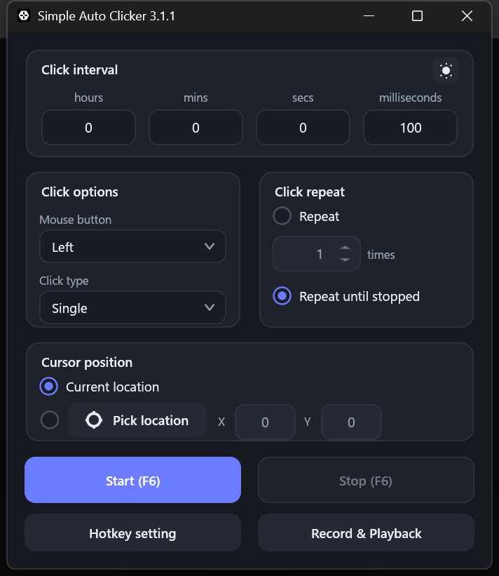

| Light theme | Record & Playback |
| --- | --- |
| 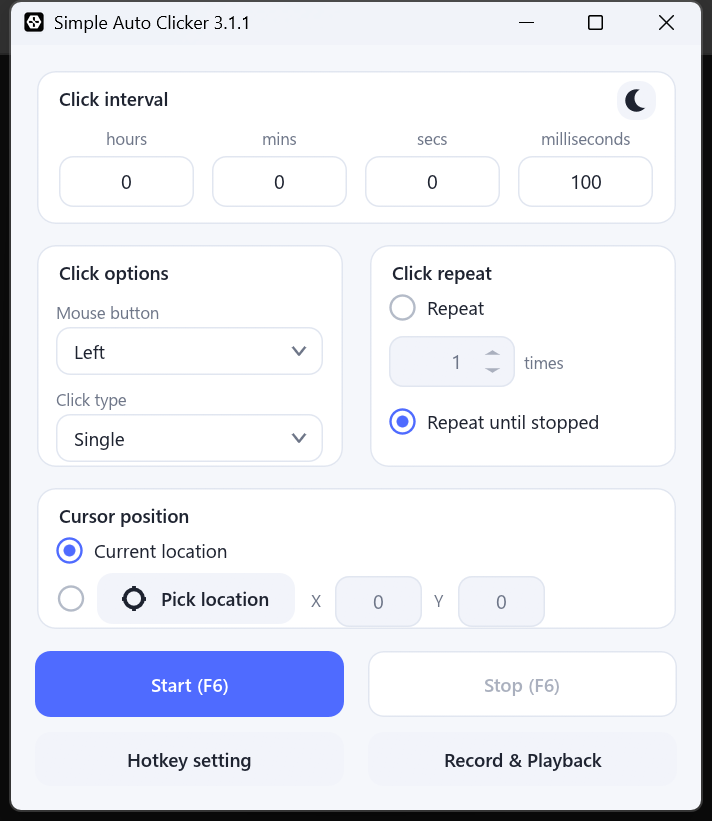 | 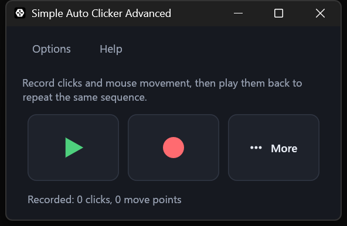 |

## Features

- **Click interval** — hours, minutes, seconds and milliseconds.
- **Mouse button** — left, right or middle; single or double clicks.
- **Click repeat** — a fixed number of times or until stopped.
- **Cursor position** — the current location or a fixed point picked from the screen.
- **Global hotkey** — start / stop with `F6` by default; any key can be assigned.
- **Record & Playback** — records clicks *and* mouse movement with their original timing,
  then replays the sequence. Separate hotkeys, optional auto-minimize while recording or
  playing, and clicks on the app's own window are ignored while recording.
- **Themes** — System, Light or Dark, switched live, including dark window title bars.
- **Settings persistence** — theme, hotkeys and minimize options survive a restart.

## Screenshots

| Theme menu | Record & Playback menu |
| --- | --- |
| 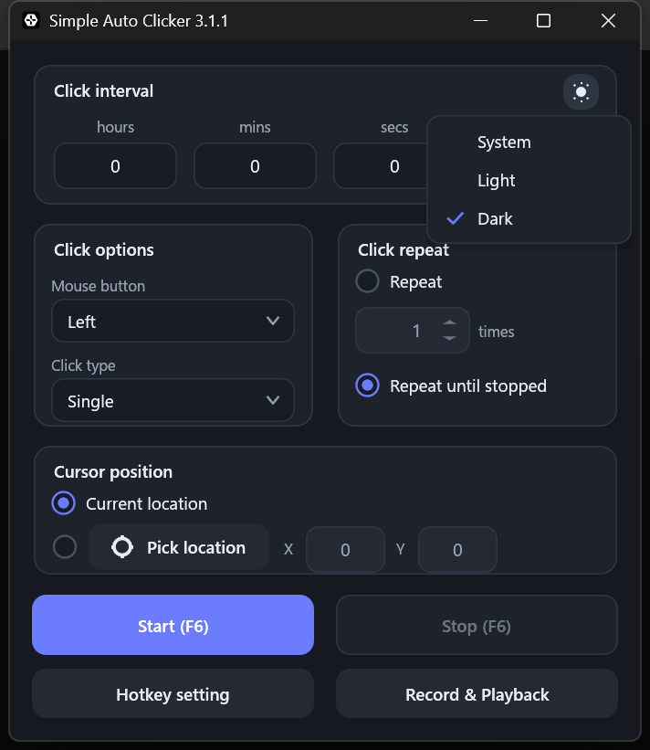 | 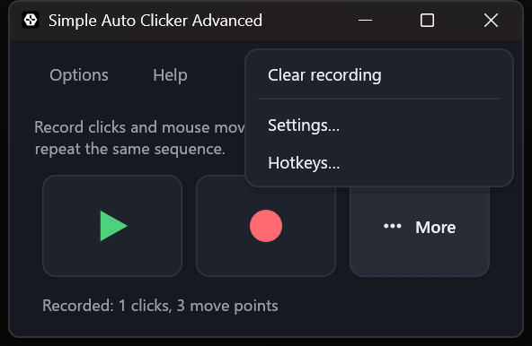 |

| Recorded a sequence | Playing it back |
| --- | --- |
| 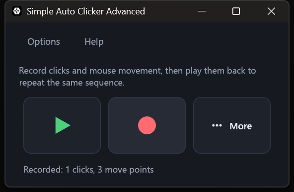 | 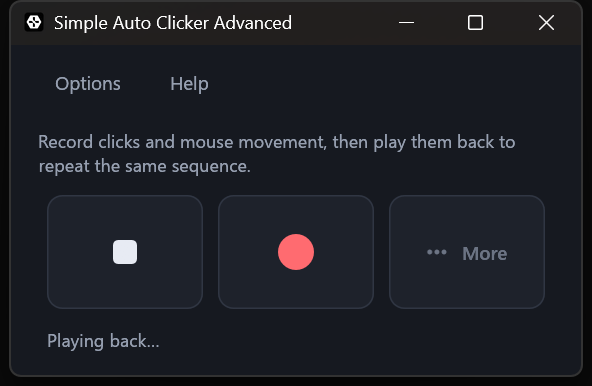 |

| View settings | Hotkeys for Record & Playback |
| --- | --- |
| 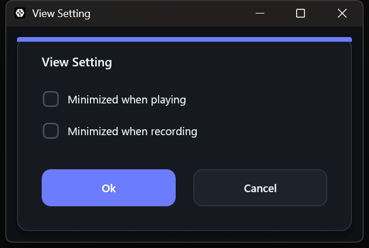 | 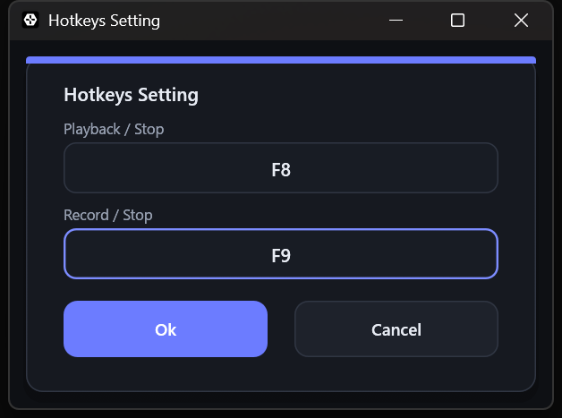 |

| Pick location | Hotkey setting |
| --- | --- |
| 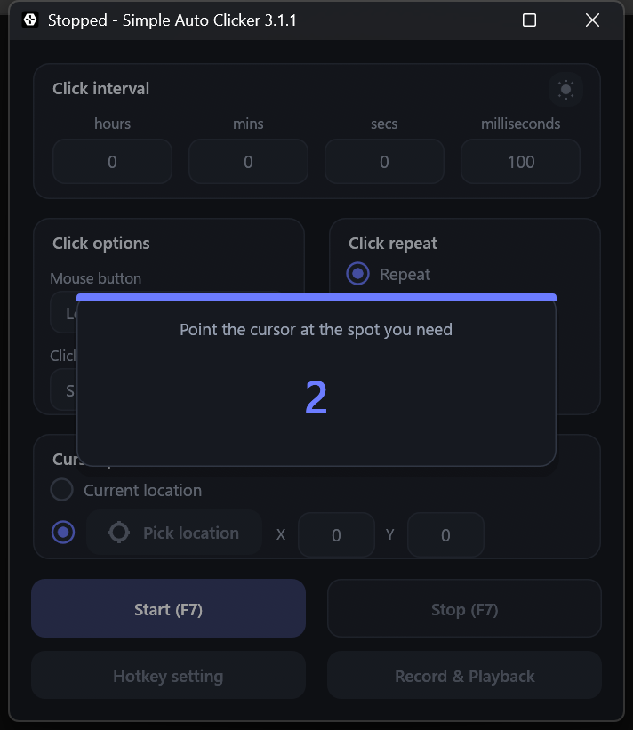 | 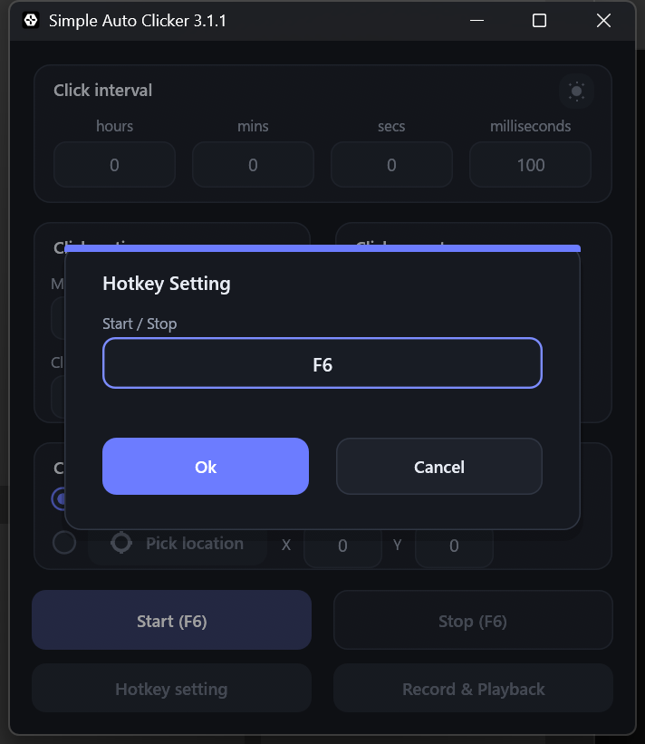 |

Another program may already own a key; in that case the previous hotkeys are kept
and the app explains why:

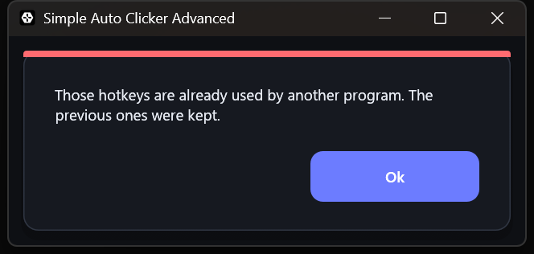

## Requirements

- Windows 10 or 11 (64-bit).
- To build: a stable Rust toolchain with the MSVC target, e.g. installed through
  [rustup](https://rustup.rs) plus the Visual Studio Build Tools (Desktop development
  with C++). No other runtime is needed.

## Build and run

```powershell
git clone https://github.com/fay9to/simple-autoclicker.git
cd simple-autoclicker
cargo build --release
.\target\release\SimpleAutoClicker.exe
```

The result is a single self-contained `SimpleAutoClicker.exe`; there is no installer.

## Usage

### Main window

1. Set the click interval.
2. Pick the mouse button and click type.
3. Choose how many times to repeat (or leave *Repeat until stopped*).
4. Pick *Current location* or *Pick location* and click the screen point.
5. Press **Start** (or the hotkey) — the window title shows the current state.

### Record & Playback

1. Open **Record & Playback** on the main window.
2. Press **Record**, perform the clicks and mouse movements you need, then press **Stop**.
3. Press **Play** to repeat the recording with the same timing.

Clicks on the record window itself are ignored while recording, so pressing **Stop**
does not end up in the recording. A recording is kept in memory only and disappears
when the app is closed. The main window is replaced by the record screen; closing it
(`Alt+F4` or the title-bar button) returns to the main window.

## Hotkeys

| Action | Default key |
| --- | --- |
| Start / stop clicking | `F6` |
| Start / stop playback | not assigned |
| Start / stop recording | not assigned |

All three can be changed in the app: **Hotkey setting** on the main window, and
**More → Hotkeys…** on the record screen. The record screen hotkeys are only active
while that screen is open. A global hotkey works while the window is minimized, and
stopping a minimized recording restores the window.

## Settings

The app stores its settings in:

```
%LOCALAPPDATA%\SimpleAutoClicker\settings.ini
```

It keeps the chosen theme, the hotkeys and the two minimize options. Delete the file to
return to the defaults. No other data is written to disk. The format matches the earlier
WinForms build in `csharp/`, so an existing settings file keeps working.

## Project layout

| File | Purpose |
| --- | --- |
| `src/main.rs` | entry point, window setup, loads settings |
| `src/app/mod.rs` | application state, hotkeys, dialogs, background logic |
| `src/app/main_screen.rs` | main window layout and actions |
| `src/app/advanced_screen.rs` | record & playback screen |
| `src/app/menus.rs` | popup menus and their actions |
| `src/engine.rs` | click loop running on a background thread |
| `src/native.rs` | Win32 calls: mouse input, window lookup, dark title bar, DPI |
| `src/hotkeys.rs` | global hotkeys on a dedicated message-loop thread |
| `src/hooks.rs` | low-level mouse hook used by the recorder |
| `src/record.rs` | recording storage, filtering and playback thread |
| `src/theme.rs` | light / dark palettes, fonts, hand-drawn icons |
| `src/widgets.rs` | owner-drawn buttons, fields, selects, radios, checkboxes, menus |
| `src/dialogs.rs` | hotkey dialogs, pick-location countdown, message dialogs |
| `src/settings.rs` | settings file |
| `src/keys.rs` | virtual-key names and conversions |

## Legacy C# implementation

The original Windows Forms implementation this project replicates is kept in
`csharp/` for reference. It targets .NET 9 and can still be built separately:

```powershell
cd csharp
dotnet build -c Release
```

Screenshots of that build are in `docs/csharp/`.

## Notes

- Only one window can own a given global hotkey. If the key is already taken by another
  program, the app keeps the previous binding and tells you about it.
- The app does not require administrator rights; elevated windows may ignore synthetic
  clicks.
- The executable name is `SimpleAutoClicker.exe` even though the Cargo package is called
  `simple-autoclicker`.
